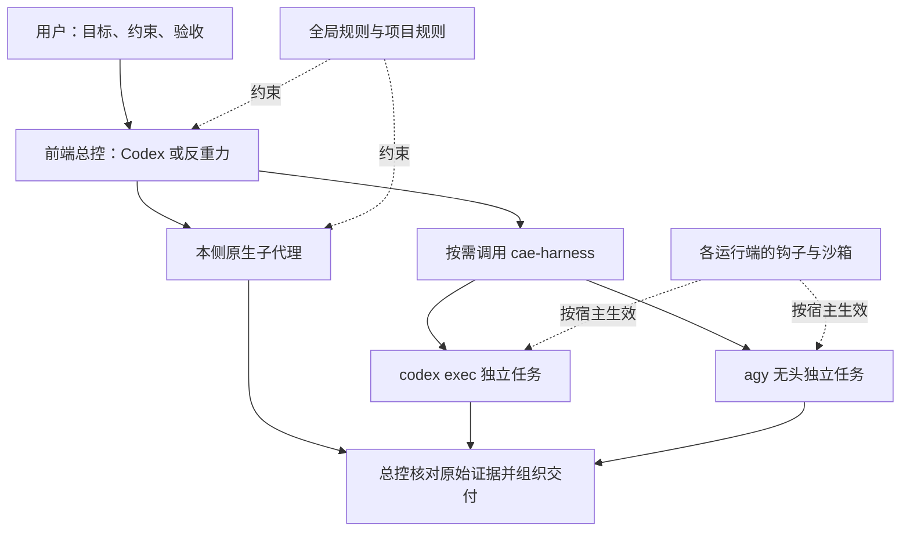

# Codex 与反重力：统一规则、独立工作流和双向协作

本仓库维护 Codex 与 Google Antigravity（反重力）的通用工程／科研配置。两端都可以独立使用；需要另一端协作时，再通过 `cae-harness` 发起明确范围的 CLI 任务。适用于代码维护、技术文档和 CAE／CFD／数值分析工作，不依赖某个求解器或某台计算机。

脚本仅使用 Python 标准库，要求 Python 3.9+。编辑复杂的既有 TOML 配置建议使用 Python 3.11+；安装器无法可靠解析时应保留原文件并报告，不猜测改写。

## 一、为什么配置这些规则、钩子和流程

长任务的风险常出在任务管理和证据传递：压缩后漏掉用户的补充要求，审查者同时修改被审查文件，子任务失败却被总结成“通过”，或把临时工作写进其他项目。模型越能自主工作，这些边界越需要说清楚。

| 遇到的问题 | 本仓库的安排 | 作用与边界 |
| --- | --- | --- |
| 每个新项目都重复解释语言、文件组织和工程要求 | 共用全局规则，项目另有自己的 `AGENTS.md` | 固定长期偏好：简体中文、规范术语、文件最少、先核对再改动；具体物理模型、数值格式和验收容差仍由项目定义 |
| 压缩或续接后丢失原话、插话和最新裁定 | 原话归档与恢复钩子 | 从可核对的宿主记录恢复依据，报告完整性与缺口；归档不是替用户改写需求，也不能保证模型每次都正确理解 |
| 审查时顺手改文件，导致无法独立复核 | 三个只读角色，发现交回总控确认 | 将读取、审计与修改分开；角色指令、工具白名单和操作系统沙箱是不同层次的约束 |
| 越界写入、外部 worktree 或错误安装目标 | 项目边界规则、安装预检、宿主沙箱和工具检查 | 项目外业务写入须明确批准；标准临时目录和正常运行记录按规则使用。钩子只检查其能识别的动作，不能代替完整的系统隔离 |
| 同一日志被反复轮询、等待回复刷屏 | 证据指纹与重复回复检查 | 有新证据才重复检查；残差、步数等真实进展不按重复废话处理 |
| 长会话已经难以可靠续接，却继续扩张任务 | 提醒、局部收尾和交接流程 | 两端共用交接目标，分别适配宿主。Codex 首次安装默认只提醒；交接完成、结束当前回合、取消目标和停止后台计算必须分别核对 |
| 所有任务都用最高推理挡或层层自动派生 | 前端选择与后台选路分开 | 尊重用户主会话选择；后台按任务选模型和挡位，默认不再开启内部二次自动委派，控制无依据的并发放大 |
| 模型说“读完／通过”，但缺少实际记录 | 结构化回执、读取覆盖清单和指定命令验收 | 配置存在、离线测试、实际宿主触发和算例实测分别记账；编译成功不替代守恒量、收敛阶或物理验证 |

规则表达用户的长期要求，钩子执行部分机械检查，模型负责分析和实施，总控负责核实证据。这些机制减少重复管理，也保留关键方法和项目外写入由用户裁决的权利。

## 二、谁调用谁：原生子代理、复合模式与 `cae-harness`

### 四种机制分别管什么

| 机制 | 在哪里运行 | 是否形成独立任务上下文 | 模型与挡位由谁决定 |
| --- | --- | --- | --- |
| 主会话的单模型 | Codex 或反重力当前聊天 | 当前主上下文 | 用户在客户端选定；后台任务不反向覆盖该选择 |
| 宿主复合模式 | 宿主内部 | 取决于具体机制，见下文 | 宿主编排；不能用普通推理挡位的概念一概解释 |
| 本侧原生子代理 | 当前客户端的原生代理系统 | 宿主管理子上下文；继承方式依接口和调用参数 | 总控通过原生接口选择角色、可用模型和挡位 |
| `cae-harness` 独立 CLI 任务 | 新启动的 `codex` 或 `agy` 进程 | 独立 CLI 会话，需要任务单提供背景 | 脚本根据实际执行端目录、任务和显式参数解析，并将选路结果和启动参数写入回执 |



`cae-harness` 是本仓库维护的**技能说明和 Python 编排脚本**，不是新模型、云服务或常驻总控。技能告诉助手何时调用，脚本完成后端发现、模型与预算解析、进程启动、回执校验、改动范围检查、超时取消及额度熔断。只有调用它的入口才运行；安装了技能并不意味着每条消息都会自动调用另一端。

### 两端原生子代理怎样使用

- **Codex**：总控通过宿主提供的原生代理工具（如本环境的 `spawn_agent`）分配独立工作。角色来自 `~/.codex/agents/*.toml`；模型、推理挡位、历史继承和并发能力以当前宿主接口为准。`cae-harness` 不拦截或接管这些原生调用，也不能替原生接口传入它不支持的上下文参数。
- **反重力**：总控通过 `invoke_subagent` 调用内置或 Markdown 自定义角色。官方说明其子上下文从新任务开始，需要任务单给出背景；工作目录可继承、共享或使用宿主支持的 worktree。创建 worktree 仍须遵守本仓库的项目边界要求。角色的 `model: inherit` 等设置属于宿主继承机制，与 `cae-harness --engine` 不同。[反重力子代理说明](https://antigravity.google/docs/subagents/)
- **本仓库的三个角色**：`readonly-reader` 负责原文通读与摘录，`readonly-auditor` 负责证据核验，`readonly-collaborator` 负责方向分析、技术润色和数学工作。反重力角色限定读取／搜索及结构化回执工具；Codex 原生角色有严格行为指令，但仍继承宿主权限，不能称为独立的操作系统只读沙箱。

日常可以直接说：

> 请用本侧只读子代理分别核对安装流程、模型选路和钩子逻辑，给出文件行号；不要修改文件，由你复核并实施。

“本侧子代理”不要求经过 `cae-harness`。独立阅读可以并行；同一文件的修改、共享资源和最终验收仍由总控协调。

### Orchestrator、`ultra` 与多代理是什么关系

反重力 **Orchestrator（Carbon／Argon）** 在同一个 agent、同一任务轨迹内，由 Carbon 或 Argon 规划和审阅，Hydrogen 实施，遇到意外时再交回规划模型。它不是先把整条请求分类给一个模型的静态路由器，也不是单纯把 `high` 再调高一级；其配置固定，不能通过 `--effort` 调挡。本机官方 CLI 的只读 `/effort` 查询也返回不可调。需要多个并行 agent 时，使用原生子代理、`/swarm`、`/boost` 或 `/teamwork` 等相应功能；具体权限和可用性由宿主决定。[Orchestrator 官方说明](https://antigravity.google/docs/models)

Codex 的 **`max`** 给选定模型更多单任务推理预算；**`ultra`** 会使用子代理处理可拆分的工作。二者不应当成仅差一个数值的同类挡位，也不能把 `ultra` 当作反重力 Orchestrator 的同义词。[Codex 模型与挡位](https://learn.chatgpt.com/docs/models)

本仓库允许用户在前端选这些宿主模式。后台默认选择单模型执行；`ultra` 须显式传入 `--tier ultra`。复合模型既可由 `--engine` 指定，也可由任务单中明确的模型选择指令指定；正文只是讨论模型或挡位名称不构成授权。显式选择固定配置的 Orchestrator 时，回执应标明“固定配置”，不附加或声称生效一个可调推理挡位。CLI 子任务也不应再次调用本编排器形成无界委派链。

## 三、模型、挡位与上下文能力矩阵

**最近核验：2026-11-13。** 下表是有日期和来源的维护快照；真实调用仍以运行侧当前可用目录为准。公开模型规格、客户端目录声明、配置值和运行实测分别列出，不把某个账号或某次运行的数值推广为所有环境的保证。

### 模型与模式

| 客户端／模型或模式 | 公开定位与本仓库用法 | 可调强度／复合特性 | 上下文依据 |
| --- | --- | --- | --- |
| Codex：Astra | 复杂分析、困难推导与高要求端到端工作 | 当前目录提供 `low/medium/high/xhigh/max/ultra`；后台默认不选 `ultra` | 本次客户端目录：默认 `272,000`、声明最大 `872,000` token |
| Codex：GPT-6.1 Sol | 复杂工程、长任务和常规实现的主力候选 | 当前目录提供上述六挡 | 官方默认 `500,000`；本次目录声明最大 `872,000` token |
| Codex：GPT-6.1 Terra | 文字、视觉理解、计算机操作及范围明确的代码工作 | 当前目录提供上述六挡 | 本次目录：默认 `500,000`、声明最大 `872,000` token |
| Codex：Luna | 清晰、重复、范围小的检查与提取 | 当前目录到 `max`，不含 `ultra` | 本次目录：默认 `272,000`、声明最大 `872,000` token |
| 反重力：Gemini 4 Carbon／Argon | 复杂工程、科研、规划与审阅；具体选择须结合任务验证 | 当前 CLI 目录有 `low/medium/high`；两者的“最高可用挡”是 `high`，不是凭空添加 `max` | Google 模型表列 API 总窗口 `1,048,576` token；不能据此断言反重力会话可放入同等大小的源码 |
| 反重力：Gemini 4 Hydrogen | 日常实施、维护和较快的代理工作 | 当前 CLI 目录有 `low/medium/high/xhigh` | Google 公布约 1M 窗口；输入、思考及输出的具体预算须按当前模型/API和宿主分别核对 |
| 反重力：Orchestrator（Carbon／Argon） | 同一任务内的规划—实施交替，适合需要减少手动切换的日常开发 | 固定复合配置，`--effort` 不适用；与并行子代理不同 | 两个组成模型的窗口不能相加。当前 CLI 模型列表不提供该模式的会话窗口数值 |
| 反重力目录中的其他模型 | 是否可用以当前账号和客户端为准 | 不从名称、排序或最大挡位推断一定更好；第三方额度池默认不自动消耗 | 未取得该模型与该运行端的可靠数据时明确记为未知 |

模型定位及 Codex 挡位以[OpenAI 当前说明](https://learn.chatgpt.com/docs/models)为依据；反重力模式与变体以[当前模型说明](https://antigravity.google/docs/models)、[2026-11-12 Hydrogen／Orchestrator 公告](https://antigravity.google/blog/gemini-4-hydrogen-in-google-antigravity)及本机官方目录查询交叉核对。Google 的[模型迁移表](https://docs.cloud.google.com/gemini-enterprise-agent-platform/models/migrate)列出 Gemini 4 的统一输入／输出预算；这些是 API 规格，不是对 Antigravity 客户端压缩阈值的承诺。

Codex 表中的最大窗口来自本次官方客户端缓存元数据，`model/list` 主要提供可用模型、挡位等信息，不直接提供窗口上限。代码必须按**实际执行侧和最终模型标识**读取其对应元数据，不把这张表的数字写死进选路逻辑。本机原生子任务的遥测曾报告 `828,400` token 有效窗口，与 `872,000 × 95%` 相符；这仍不是同等规模输入的压力测试，不能据此承诺实际压缩时刻。

### “最大窗口”如何落实

本项目已确定：**后台子任务使用最终选中模型自身声明的最大窗口；没有可靠最大值时保留该模型默认值。实际材料按需载入。** 前端主会话的模型与挡位保持用户选择。此策略以宿主接口支持的配置项为限；Codex 子模型若连默认窗口也未知、同时宿主存在全局窗口覆盖，编排器会阻止启动并要求刷新目录，避免误借另一模型的上限。

| 概念 | 含义 | 不应混淆的地方 |
| --- | --- | --- |
| 模型窗口声明 | 某个模型目录或官方规格给出的容量 | 不同模型、客户端、账号和版本可能不同；不能借主会话模型的上限给另一个子模型 |
| 本次执行窗口 | 实际 CLI 调用采用的窗口设置 | Codex 可按所选模型给出本次覆盖；原生子代理和反重力 CLI 的可控项由其宿主接口决定 |
| 压缩阈值 | 宿主何时整理旧历史 | 不是模型最大窗口，也不是净源码输入上限；Codex 的有效窗口百分比字段也不等于已经测得的压缩时刻 |
| 任务输入预算 | 为文件、提示词、清单、结构化输出和后续工具留余量的规划值 | 字节估算不是精确 tokenizer 计数；`--agy-input-budget` 等参数不能给宿主“扩容” |
| 实际覆盖 | 本次读到了哪些材料、怎样压缩、结果是否通过验收 | 不能由计划清单或模型自述直接推定全量阅读、无压缩或全局结论正确 |

反重力当前 `/context` 会分别显示模型窗口占用、工具和定制内容开销、检查点缓冲等信息；自动压缩用检查点继续长会话。该面板目前不支持无头 `-p` 调用。本仓库因此不把历史上的某个固定 token 阈值写成所有新模型的宿主限制，也不把 API 的 1M 规格当作客户端无压缩承诺。[反重力上下文说明](https://antigravity.google/docs/cli/commands/context/)

**压缩不是自动重做的触发器。** 先恢复原话并核对阅读覆盖与验收证据；确有缺口时补读或对只读任务做有界补审。写入任务保留已有成果与差异，不因一次压缩就从头再执行。强耦合审计应联合检查跨片依赖，例如 DGSEM 的体积分、界面数值通量和离散度量项，不能把各片“未发现问题”合成未经联合验证的整体结论。

### 本仓库的任务挡位策略

厂商的日常建议通常从默认挡位起步，再按结果调整；“同名挡位”跨模型并不代表相同计算量。本仓库针对工程／科研工作采用以下明确策略，并允许用户显式覆盖：

| 任务 | 后台策略 |
| --- | --- |
| 数学推导、路线裁决、高阶格式／守恒／稳定性及并发根因 | 适合深度分析的独立模型，采用该模型可用的单模型最高挡 |
| 常规编码、审查、审计与长篇技术润色 | `high`；文件多本身不等于推理必须升到最高挡 |
| 短篇文字润色 | `medium` |
| 表面格式、拼写与明确省额度的核查 | 轻量模型与 `low` |
| 指定命令验收失败后的排查 | 在模型支持的范围内提高强度；回执列出每轮选路结果和启动参数，不把未发生的变化称为升级 |

这些是任务策略，不是所有专业问题的模型排名。比较“最佳效果”应使用同一任务、输入和验收判据，同时看正确性、覆盖、耗时与消耗；一次短任务通过不能证明数值方法推导或大规模代码审计能力。参考[Codex 实践建议](https://learn.chatgpt.com/docs/learn/best-practices)与[反重力 effort 说明](https://antigravity.google/docs/cli/commands/effort/)。

## 四、`cae-harness` 具体怎样调用

日常由总控按已授权范围调用，也可以手工运行。代码工程通常由 Codex 总控，反重力负责方向校正、技术表述润色或独立复核；科研主题可反过来。已有项目主责以用户最新裁定为准。

| 入口 | 作用 | 是否调用模型 |
| --- | --- | --- |
| `probe` | 发现 CLI、配置与本地目录信息 | 默认不调用模型；显式目录查询另列 |
| `assess` | 报告模型、挡位、窗口来源、时效和场景建议 | 不执行业务模型任务，不修改前端配置 |
| `task --kind review/direction/polish/math` | 独立只读协作，正文与证据通过回执返回 | 是 |
| `task --kind code` | 在明确文件范围实施代码，可附验收命令 | 是 |
| `audit` | 按实际模型预算安排单次或分片审计，登记阅读覆盖 | 是 |
| `gate` | 代码实施后运行指定验收命令，限定失败修复轮数 | 是 |

在仓库根目录执行（Windows 用 `python`，WSL／Linux 用 `python3`）：

```sh
python -B template/user-guard/skills/cae-harness/scripts/cae_harness.py assess --caller codex

# Codex 发起反重力只读协作；任务单须写清背景、文件范围和输出要求
python -B template/user-guard/skills/cae-harness/scripts/cae_harness.py task --caller codex --engine agy:default --kind polish --target "<项目目录>" --task-file "<任务单.txt>" --tier medium --dry-run

# 反重力发起 Codex 独立数学工作
python -B template/user-guard/skills/cae-harness/scripts/cae_harness.py task --caller antigravity --engine codex:default --kind math --target "<项目目录>" --task-file "<任务单.txt>" --dry-run
```

核对预演后去掉 `--dry-run` 才真正派工。预演按现有目录生成计划；正式执行可能刷新目录并重新选路，以最终启动回执为准。`--caller` 指实际发起方；`--engine` 指执行后端和模型；`--kind` 描述任务；`--tier` 是明确的挡位请求。固定配置模型、不可用挡位、未知窗口或回退环境的差异须在回执中解释。

原生子代理和独立 CLI 任务都需要足够背景。CLI 子任务不会自动继承桌面聊天、打开的页签或全部外部连接器。任务单应包含最新裁定、Git 基线、工作目录、允许写入范围、输入文件和验收要求。Codex CLI 子任务使用 `--ephemeral`；反重力无头任务使用独立 CLI 存储，结果交回发起方总控。详情见[共享技能](template/user-guard/skills/cae-harness/SKILL.md)。

额度不足返回 `quota_exhausted` 并熔断，不能靠另一在途任务成功或换运行侧悄悄解除。只有确认额度恢复后显式使用 `--retry-quota` 才重新尝试。成功、部分完成、输出无效、超时、越界和验收失败分别报告；总控还要核对实际文件与命令输出。

## 五、安装与各端生效位置

1. **单 Codex（`--app codex`）**：全局规则、三个角色、原话恢复与交接钩子、配置基线和可选 Zotero MCP。
2. **单反重力（`--app antigravity`）**：`user-guard` 插件中的规则、角色、生命周期钩子与共享技能。
3. **双端（`--app both`）**：部署两套独立工作流，按需通过共享技能协作；不要求每项任务都跨端。

| 内容 | Codex | 反重力 |
| --- | --- | --- |
| 全局规则 | `~/.codex/AGENTS.md`，保留已有本机说明段 | `~/.gemini/config/plugins/user-guard/rules/AGENTS.md` |
| 本侧角色 | `~/.codex/agents/*.toml` | 插件的 `agents/*.md` |
| 原话恢复与交接 | `~/.codex/hooks/` 与 `hooks.json` | 插件的 `hooks/` 与 `hooks.json` |
| 共享技能 | `~/.codex/skills/cae-harness/` | 插件的 `skills/cae-harness/` |
| 模型与运行配置 | 当前生效的 Codex 配置层 | 反重力 App／CLI 各自生效的设置 |

Windows 与 WSL 有各自的用户目录、程序和登录态。发现配置痕迹不等于客户端可执行，更不等于已登录。跨子系统回退必须先确认实际执行侧，再使用那一侧的模型目录、额度和路径；不把 Windows 缓存当作 WSL 原生程序的能力证明。

### 快速配置

```sh
git clone https://github.com/Xinyu-Li-1997/Antigravity_Codex_configuration.git
cd Antigravity_Codex_configuration
python -B install.py --probe-apps
python -B install.py --dry-run --yes
```

也可以让任意一端的助手先读取本仓库的 [AGENTS.md](AGENTS.md) 和本说明，再说：

> 请先探测并预演本机工作流配置，列出实际目标路径，保留我已选择的模型、挡位和本机说明。

不同宿主的规则发现方式不同，不以“打开仓库”代替对文件是否加载的核对。只发现一端时，可选择安装另一端，也可仅配置当前客户端。正式写入全局目录须遵守 R4 的明确授权。

Windows 入口为 `powershell -NoProfile -ExecutionPolicy Bypass -File .\install.ps1`；Linux／macOS／WSL 入口为 `bash install.sh`。常用参数如下：

| 参数 | 含义 |
| --- | --- |
| `--app auto/codex/antigravity/both` | 选择部署端；命令中只填其中一个值 |
| `--probe-apps` | 只读探测，标准输出为 JSON |
| `--dry-run` | 预演，不写入安装目标 |
| `--yes` | 对已确定范围使用非交互安装 |
| `--sync-model-defaults` | 明确要求同步模型默认值；普通升级保留已有选择 |
| `--no-model-config` | 完全跳过模型配置，与上一项互斥 |
| `--codex-handoff-mode advisory/enforce/off` | 显式选择交接策略；首次默认提醒，升级应保留已选策略 |
| `--codex-handoff-compactions N` | 非负整数策略阈值；首次默认 `0`，不按次数自动强停 |
| `--no-zotero` | 跳过可选文献工具配置；未找到工具时安装器会提示并跳过 |

Codex `advisory` 记录观测并提醒；`enforce` 只在明确策略和受控验收后启用。更新钩子后必须检查宿主信任状态，不能用脚本文件已经复制来代替触发验收。安装器在宿主支持的 `hooks.json` 描述字段保存自己的策略标记，以区分“首次安装”和“此前明确关闭”；保留用户的其余描述。旧版 `off` 若没有该标记，无法仅由缺少处理器推断曾经关闭，迁移时须显式传 `--codex-handoff-mode off`。

安装器要求 Python 3.9+。3.9／3.10 的内置兼容解析仅支持常见单行 TOML 子集，复杂配置需 Python 3.11+；即使版本满足要求，不能安全保留语义和原文的配置也会被拒绝，并保留原文件。

## 六、升级矩阵怎样维护，怎样验收

**矩阵直接维护在本 README，不另建重复的静态模型清单。** 客户端、模型目录或宿主协议变化时，按以下顺序更新：

1. 核对当前官方模型页、CLI／宿主版本和变更说明，记录查证日期。区分模型能力、产品入口和账号可用性，不用旧发布文章覆盖新说明。
2. 运行 `probe`／`assess`；需要时显式查询官方模型目录。按具体模型核对默认窗口、声明最大窗口、可用挡位、复合模式与来源时效。缺失字段保留“未知”，不由名称或顺序猜测。
3. 先确定实际执行侧和最终模型，再生成输入预算与分片；检查实际启动参数和回执一致。遇到环境回退须重新解析，不沿用另一侧模型和额度信息。
4. 在临时目录验证单 Codex、单反重力和双端安装，并执行相关回归。安装过程应保留已有配置，拒绝无法可靠合并的格式及越界链接；不能通过执行未核验的历史钩子命令来“验证”它。
5. 用受控真实会话验证改动涉及的模型调用、钩子事件、恢复与停止行为。分别记录配置层、离线层和宿主实测层；基准任务的物理定义、数值容差和验收断言不得放宽。
6. 总控复核子代理发现，反重力润色最终文档；检查公开内容脱敏后提交推送。获准后按同一提交同步实际安装端，检查信任状态和内容一致性。

```sh
# 临时隔离安装；不要把占位路径直接用于生产
python -B install.py --app codex --codex-home "<临时目录>/codex_home" --no-zotero
python -B install.py --app antigravity --target-dir "<临时目录>/plugins/user-guard" --no-zotero
python -B install.py --app both --target-dir "<临时目录>/plugins/user-guard" --codex-home "<临时目录>/codex_home" --no-zotero

# Windows 使用 python；WSL／Linux 可替换为 python3
python -B -X utf8 -m unittest discover -s tests -p "test_*.py" -v
```

本次 `v1.6.0` 在 Windows 与 WSL 各运行 141 项离线回归（各 2 项按平台跳过），两侧三种安装模式均作隔离验证。真实调用覆盖 Codex 单模型、反重力单模型／Orchestrator 及 WSL 回退；其中一次 Luna 低挡输出无效、一次 Orchestrator 写入任务超时，失败记录保留，不将它们算作通过。Codex 与反重力 Hydrogen 的独立代码验收随后通过。

新版钩子完成真实自动压缩提醒、原话归档、严格模式阻断及交接文档验收；反重力四类生命周期事件和独立交接指令也已实测。已有 Windows Codex 真实提醒、低阈值自动压缩、跨进程续接及隔离严格模式验收见[生命周期与实机记录](docs/架构设计与生命周期钩子规范.md)。历史通过只适用于相应版本和场景；新改动必须按实际影响补验，不能直接沿用“全部通过”。

## 七、文件关系与公开边界

| 位置 | 维护职责 |
| --- | --- |
| `README.md` | 使用入口、配置理由、层级关系和带来源的能力矩阵 |
| `AGENTS.md` | 当前助手维护本仓库时的探测、预演、权限和发布要求 |
| `install.py`、`install.ps1`、`install.sh` | 单端／双端安装、预检、保留已有设置和平台适配 |
| `template/user-guard/` | 反重力插件及双端共用的规则、恢复／交接实现、`cae-harness` 唯一源码 |
| `template/codex/` | Codex 钩子注册和原生只读角色模板 |
| `docs/` | [协作实践](docs/反重力全域工程化最佳实践指南.md)与[生命周期技术规范](docs/架构设计与生命周期钩子规范.md) |
| `tests/` | 对应边界的离线回归；真实宿主测试另行提供运行证据 |

公开仓库不收录个人路径、硬件资料、认证信息或原始会话。测试中的 `alice`、`<user>` 等为占位；文本扫描和测试只证明其覆盖范围，不能宣称穷尽所有隐私形式。公开作者署名和仓库地址保留。

本仓库仅通过用户从官方渠道安装并登录的 `codex`、`agy` CLI 及可选文献工具工作，不分发专有客户端或认证凭据，不包含绕过官方认证、权限或计费的机制。代码任务受宿主沙箱及已授权范围约束，执行前后差异检查不能撤销已经发生的副作用。

采用 [Apache License 2.0](LICENSE)，`Copyright 2026 Xinyu-Li-1997`。软件按许可证的“原样”条款提供；分发与修改要求以许可证正文为准。
