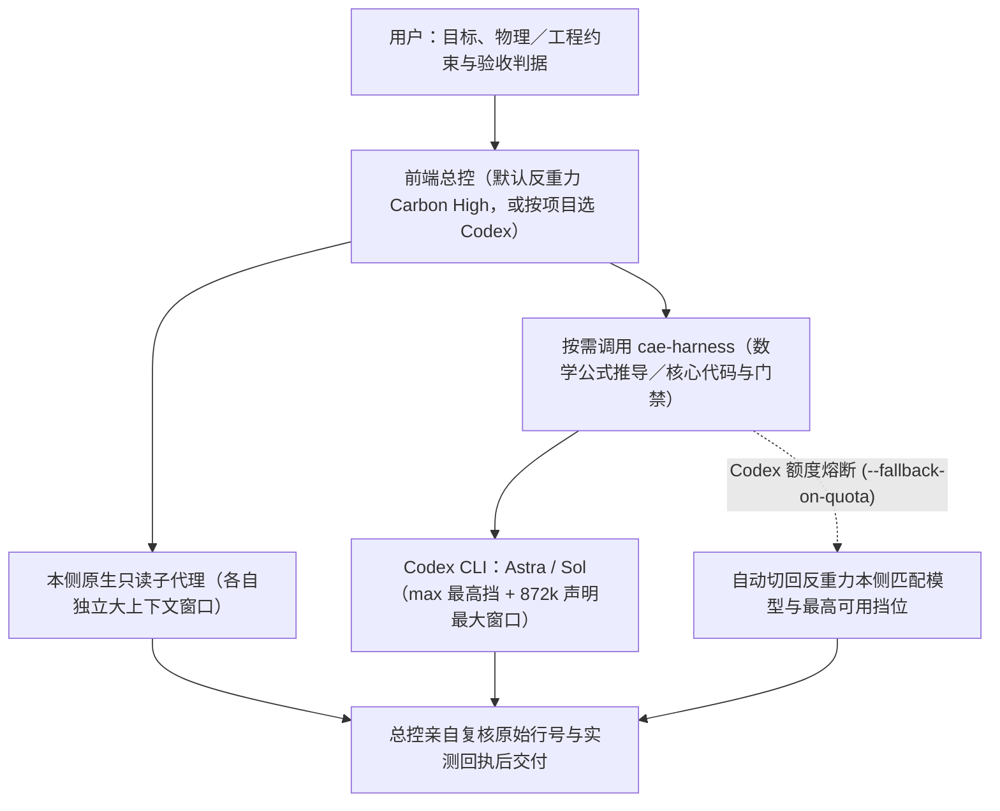

# 反重力与 Codex：统一工程规范、独立工作流与双向协作配置

本仓库（`Antigravity_Codex_configuration`）维护 Google Antigravity（反重力）与 OpenAI Codex 共用的工程与科研工作流配置。两个客户端既能各自独立闭环工作，也能通过共享的 `cae-harness` 技能按专长协同攻坚，适用于通用代码工程、技术写作以及 CAE／CFD／数值分析与高性能计算研究。

仓库内所有脚本仅使用 Python 标准库（要求 Python 3.9+；若需自动合并带复杂表结构的既有 `config.toml`，建议使用 Python 3.11+，遇到无法安全解析的配置时安装器会保留原文件并给出提示）。

## 一、这套配置解决什么实际问题

长周期科研与工程会话最容易在交接和边界上出岔子：上下文压缩后漏掉用户的补充约束、审查子代理顺手改掉被审源码、算例没跑通却被归纳成“已验证”、临时文件写进其他项目目录，或是跨端调用遇到额度耗尽后原地死循环重试。本仓库用“规则约束 + 生命周期钩子 + 编排脚本”把这些环节管住：

| 常见痛点 | 本仓库的做法 | 实际作用边界 |
| --- | --- | --- |
| 每个新项目都要重复交代中文规范、目录精简和验收标准 | 统一全局规则 `R0–R11`，具体物理模型与数值容差留在项目 `AGENTS.md` | 固化通用工程习惯，不覆盖具体课题的物理方程与收敛判据 |
| 会话压缩或续接后丢掉早期诉求、插话和最新拍板 | 压缩／恢复钩子自动从本地轨迹提取并归档用户原话 | 完整保留原始指令供模型重读核对；存在截断缺口时如实标明 |
| 审查时顺手改代码，失去独立复核意义 | 三个严格只读角色（通读摘录、审计核验、方向／数理协作） | 读写职责分离，审查结论必须附文件行号交回总控复核 |
| 越界改其他项目、建外部 `git worktree` 或误改全局配置 | `R4` 目录硬边界 + 安装预检 + `PreToolUse` 检查与宿主沙箱 | 项目外写入须经用户明确批准；标准临时目录与运行缓存正常放行 |
| 同一个算例日志被反复轮询、等待过程同质回复刷屏 | 日志复合指纹门禁 + `Stop` 数值进展识别守卫 | 文件有新内容或残差／步数有更新才放行，拦住原地空转刷屏 |
| 超长会话已经频繁压缩丢上下文，却还在继续铺摊子 | 长会话预警、排空（`drain`）、冻结（`freeze`）与结构化交接 | 反重力自动收口核验交接提示词；Codex 默认采用 `advisory` 提醒 |
| 不分轻重缓急乱选模型，或对侧额度耗尽后卡死 | 主会话尊重用户选择，后台按任务专长选模选挡，支持额度熔断与本侧接管 | 攻坚用单模型最高挡与最大声明窗口，默认禁用 `ultra` 套娃裂变 |
| 嘴上说“全部读完／验证通过”，实际缺运行依据 | 结构化 JSON 回执、阅读覆盖清单与 `--verify-cmd` 硬门禁 | 严格区分“源码存在”“离线测试通过”与“真实宿主／算例实测” |

## 二、协作架构：原生子代理、复合模式与 `cae-harness`

### 1. 四类执行层各管什么

| 层级 | 运行位置 | 上下文窗口形态 | 模型与推理挡位谁定 |
| --- | --- | --- | --- |
| 前端交互主会话 | 反重力或 Codex 当前聊天窗 | 当前主会话窗口 | 用户在客户端直接选定，后台脚本绝不反向篡改 |
| 宿主内置复合模式 | 宿主内部（如反重力 `Orchestrator`） | 单一会话内多模型交替共享同一窗口 | 宿主固定编排，不支持外部 `--effort` 调挡 |
| 本侧原生子代理 | 反重力 `invoke_subagent` 或 Codex `spawn_agent` | 每个原生子代理拥有独立的子会话上下文窗口 | 主线程按宿主原生接口指定角色与继承／显式模型 |
| `cae-harness` 跨端 CLI | 独立启动的 `codex exec` 或 `agy` 无头进程 | 全新独立 CLI 会话，按所选模型声明最大窗口配置 | 脚本按任务专长自动匹配或按 `--engine`／`--tier` 显式指定 |



`cae-harness` 是本仓库维护的本地 Python 编排脚本与技能说明，**只调用用户在本机通过官方渠道安装并登录的 `codex` 与 `agy` CLI**，不经过任何第三方中转或非官方接口，也不在未调用时常驻后台。

### 2. 日常推荐工作流：反重力主控 + Codex 专长攻坚 + 额度熔断回退

1. **反重力主会话与本侧原生子代理（大上下文统筹）**：
   - 日常科研与综合工程推荐在反重力前端选用单模型 **`Gemini 4 Carbon (High)`** 作总控。相比在同一窗口内交替调用 Carbon 与 Hydrogen 的固定复合模式 `Orchestrator (Carbon)`，纯 `Carbon (High)` 主会话单次持续步数更长，且通过 `invoke_subagent` 派生的 `readonly-reader`、`readonly-auditor`、`readonly-collaborator` 默认采用 `inherit`，**每个子代理都能直接继承纯 `Carbon (High)` 并获得各自独立的约 `1M` 标称上下文窗口**，非常适合并行通读长文献、梳理多模块代码和独立核验行号。
2. **数学公式推导与核心代码调用 Codex（因地制宜选 `Astra`／`Sol` + 最高挡 + 最长上下文）**：
   - 遇到偏微分方程推导、高阶格式离散（如 DGSEM／WENO 通量、雅可比矩阵、特征分解、守恒性与熵稳定分析）或核心求解器代码实现时，反重力总控通过 `cae-harness` 发起 Codex 无头任务：
     - **数学推导与路线攻坚（`math`／`direction`）**：自动优选深度推理模型 **`Astra`**（`gpt-6-astra`）；
     - **核心代码实现、大输入审计与验收门禁（`code`／`audit`／`gate`）**：自动优选最新代工程主力 **`Sol`**（`gpt-6.1-sol`，多代并存时自动选中最新代，也可显式传 `codex:astra` 或 `codex:sol`）；
     - **最高纯思考挡位与最长上下文**：数理推导与含核心公式的代码任务自动启用单模型最高非委派挡 **`max`**（跳过内部二次派生的 `ultra`），并读取该模型自身声明的最大上下文窗口（当前目录为 **`872,000` token**）下发给 `codex exec`。
3. **Codex 额度不够时自动熔断并切回反重力本侧完成**：
   - 调用时附带 `--fallback-on-quota`：一旦 Codex 返回用量耗尽或处于本地冷却期（`quota_exhausted`），且尚未修改工作区文件，脚本会立即登记 Codex 冷却状态（阻断后续无效重试），同时**自动切回反重力本侧匹配的模型与最高可用挡位（如 `gemini-4-carbon-high`）及本侧最大可用上下文**继续完成，并在回执 `quota_fallback` 中写明切换记录。

## 三、模型、挡位与上下文能力对照表

**核验日期：2026-11-13。** 下表汇总官方公开文档、本机客户端目录声明与受控实测数据；实际运行时仍以当前执行侧读取到的模型目录为准。

### 1. 双端主要模型与模式规格

| 客户端／模型 | 适用定位 | 可调挡位／运行机制 | 上下文窗口依据 |
| --- | --- | --- | --- |
| Codex：`GPT-6-Astra` | 高难度数学推导、物理建模与复杂根因分析 | 目录支持 `low/medium/high/xhigh/max/ultra`（后台最高选 `max`） | 本机目录声明默认 `272,000`、最大 `872,000` token（有效比 95%） |
| Codex：`GPT-6.1-Sol` | 核心代码实现、大规模审计与命令门禁主力 | 同上六挡（含数学／数值公式线索或传 `--tier max` 时用 `max`） | 官方默认 `500,000`；本机目录声明最大 `872,000` token |
| Codex：`GPT-6.1-Terra` | 多模态理解、界面操作与边界清晰的代码修改 | 同上六挡 | 本机目录声明默认 `500,000`、最大 `872,000` token |
| Codex：`GPT-6-Luna` | 表面格式核查、简单文本提取与轻量检查 | 目录支持至 `max`（不含 `ultra`） | 本机目录声明默认 `272,000`、最大 `872,000` token |
| 反重力：`Gemini 4 Carbon`／`Argon` | 推荐主会话总控与复杂工程科研推理 | 当前 CLI 目录提供 `low/medium/high`，单模型最高可用挡为 `high` | Google 模型文档公布 API 窗口 `1,048,576` token；客户端受检查点策略管理 |
| 反重力：`Gemini 4 Hydrogen` | 日常快速编码实现与轻量检查 | 当前 CLI 目录提供 `low/medium/high/xhigh` | `/context` 面板显示约 `1.0M`，CLI 单消息长度与检查点阈值另算 |
| 反重力：`Orchestrator (Carbon/Argon)` | 单会话内由 Carbon/Argon 规划审阅、Hydrogen 实施 | 固定复合配置，不可传 `--effort`；不等于多代理并发 | 内部子模型共享同一会话窗口，窗口容量不会叠加 |

参考来源：[OpenAI Codex 模型说明](https://learn.chatgpt.com/docs/models)、[Antigravity 模型说明](https://antigravity.google/docs/models)、[Gemini 4 Hydrogen 与 Orchestrator 公告](https://antigravity.google/blog/gemini-4-hydrogen-in-google-antigravity)、[Google Gemini 窗口规格表](https://docs.cloud.google.com/gemini-enterprise-agent-platform/models/migrate)。

### 2. 上下文窗口的五个不同层次（避免混用）

1. **API／目录声明最大窗口**：模型本身支持的最大上下文（如 Codex 目录声明的 `872,000` token、Gemini 4 API 公布的 `1,048,576` token）。`cae-harness` 调用 Codex 时会按所选模型显式下发 `-c model_context_window=<最大声明窗口>`。
2. **单条消息入口上限**：客户端 RPC 对单次输入的字符／字节限制。2026-11-13 实测中，Codex `turn/start` 单条输入上限为 `1,048,576` 字符；反重力 CLI `1.5.8` 单条输入达 44～66 万字节时出现入口截断标记，改为每轮约 13 万字节分批送入则无截断。
3. **宿主自动检查点（压缩）触发点**：客户端何时把旧历史折叠为摘要。实测 Codex `Sol` 在分轮累积至 `808,892` 输入 token（占 `828,400` 有效窗口的 97.65%）时同轮精确提取 6 项随机口令全部命中且未触发压缩；反重力 CLI `Hydrogen` 在 `241,625` 输入 token 时 6 项全中，继续追加到 `290,028` token 时触发自动检查点压缩。详细记录见[生命周期与实测规范](docs/架构设计与生命周期钩子规范.md)。
4. **分片规划输入预算**：`cae-harness audit` 为源码、提示词、文件清单与 JSON Schema 预留安全余量后的单次估算值（可通过 `--codex-input-budget` 与 `--agy-input-budget` 调整）。
5. **实际阅读覆盖**：子任务真正读了哪些文件与行号，以结构化回执和主线程抽查为准。发生上下文压缩后，先按 `R9` 恢复用户原话并核对缺口，不盲目重跑已经落盘的代码写入。

### 3. 后台任务默认思考挡位分级

| 任务场景 | 后台选路与挡位策略 |
| --- | --- |
| 数学公式推导、路线裁决、高阶数值格式／守恒性／稳定性、并发根因、门禁失败排错 | 深度推理专长模型 + 该模型支持的单模型最高挡（如 `max`／`xhigh`／`high`） |
| 常规模块编码、常规代码审查、分片审计与长篇技术润色 | 工程主力模型 + `high` 挡（也可显式传 `--tier max` 拉满） |
| 短篇文字润色（防过度发挥引发无声放大） | `medium` 挡 |
| 表面格式、拼写核查或显式省额度任务 | 轻量高速模型 + `low` 挡 |

## 四、`cae-harness` 常用命令速查

在仓库根目录可直接运行（Windows 用 `python`，WSL／Linux／macOS 用 `python3`；部署后也可在技能目录运行）：

```sh
# 1. 只读查看双端模型目录、声明窗口与各场景推荐选路
python -B template/user-guard/skills/cae-harness/scripts/cae_harness.py assess --caller antigravity

# 2. 反重力调用 Codex 推导数学公式／离散格式（自动选 Astra + max 挡 + 872k 窗口；Codex 额度不足时自动切回反重力本侧）
python -B template/user-guard/skills/cae-harness/scripts/cae_harness.py task --caller antigravity --engine codex:default --kind math --tier max --fallback-on-quota --target "<项目目录>" --task-file "<任务单.md>"

# 3. 反重力调用 Codex Sol 实现核心代码并运行验收命令
python -B template/user-guard/skills/cae-harness/scripts/cae_harness.py gate --caller antigravity --worker codex:sol --tier max --fallback-on-quota --target "<项目目录>" --task-file "<任务单.md>" --write-scope "src/*.py" --verify-cmd "python -B -m unittest discover -s tests"

# 4. Codex 调用反重力做技术表述润色（先 dry-run 预演）
python -B template/user-guard/skills/cae-harness/scripts/cae_harness.py task --caller codex --engine agy:default --kind polish --tier medium --target "<项目目录>" --task-file "<任务单.md>" --dry-run
```

> **Windows 下从 Codex 反向调用 `agy` 的沙箱注意事项**：反重力桌面／主会话调 `codex` 可直接访问宿主机 `.codex` 目录；但若在 Windows 版 Codex 的受限工作区沙箱内反向启动 `agy.exe`，沙箱默认只放行当前项目目录与 `%TEMP%`，会拦截 `agy.exe` 向 `~/.gemini/antigravity-cli` 写入运行锁与会话状态，导致进程卡住直至超时。确需从 Windows Codex 调 `agy` 时，应使用宿主放行 `~/.gemini` 写权限的执行通道，并将 `--timeout` 设为 `300` 秒以上。

完整参数与返回结构说明见 [cae-harness 技能文档](template/user-guard/skills/cae-harness/SKILL.md) 与 [协作实践指南](docs/反重力全域工程化最佳实践指南.md)。

## 五、安装、升级与生效路径

1. **单反重力（`--app antigravity`）**：安装 `~/.gemini/config/plugins/user-guard` 插件（规则、钩子、只读子代理与技能）。
2. **单 Codex（`--app codex`）**：同步 `~/.codex/AGENTS.md`（保留用户自定义 `## 工具与本机` 段落）、只读子代理、原话恢复与交接钩子及工作区沙箱基线。
3. **双端部署（`--app both` 或自动检测）**：一次配齐双端独立工作流与跨端协作技能。

| 配置项 | 反重力生效位置 | Codex 生效位置 |
| --- | --- | --- |
| 全局规则 `R0–R11` | `~/.gemini/config/plugins/user-guard/rules/AGENTS.md` | `~/.codex/AGENTS.md`（保留末尾自定义本机段） |
| 三个只读子代理 | 插件内 `agents/*.md` | `~/.codex/agents/*.toml` |
| 压缩恢复与交接钩子 | 插件内 `hooks/` 与 `hooks.json` | `~/.codex/hooks/` 与 `~/.codex/hooks.json` |
| 跨端协作技能 | 插件内 `skills/cae-harness/` | `~/.codex/skills/cae-harness/` |

### 快速体验与安装

```sh
git clone https://github.com/Xinyu-Li-1997/Antigravity_Codex_configuration.git
cd Antigravity_Codex_configuration

# 只读探测本机与 WSL 客户端状态（零写入）
python -B install.py --probe-apps

# 预演安装计划（零写入）
python -B install.py --dry-run --yes
```

也可以在反重力或 Codex 中打开本仓库，直接对助手说：

> 请按仓库 `AGENTS.md` 先探测并预演本机配置，列出拟写入路径，保留我现有的模型选择和本机自定义说明，等我确认后再正式安装。

正式安装入口：Windows 运行 `powershell -NoProfile -ExecutionPolicy Bypass -File .\install.ps1`，Linux／macOS／WSL 运行 `bash install.sh`。常用参数如下：

| 参数 | 说明 |
| --- | --- |
| `--app auto/codex/antigravity/both` | 指定部署目标（默认 `auto` 自动探测） |
| `--probe-apps` | 只读输出客户端与跨子系统探测 JSON |
| `--dry-run` | 只打印变更计划，不改任何文件 |
| `--yes` | 跳过交互确认（适合脚本化或已由用户明确批准的场景） |
| `--sync-model-defaults` | 将前端默认模型同步为推荐配置（默认升级保留用户已选模型） |
| `--no-model-config` | 完全跳过模型配置（与 `--sync-model-defaults` 互斥） |
| `--codex-handoff-mode advisory/enforce/off` | Codex 长会话交接模式（首次安装默认 `advisory` 仅提醒，升级保留原设置） |
| `--codex-handoff-compactions N` | Codex 严格模式下的压缩次数阈值（默认 `0` 不按次数强停） |
| `--no-zotero` | 跳过可选的 `zotero-mcp` 文献插件配置 |

## 六、回归测试与版本维护清单

更新模型矩阵、钩子逻辑或安装器后，按以下顺序完成验证再提交：

1. **核对目录与文档时效**：运行 `probe`／`assess` 检查最新客户端版本、可用模型、声明窗口与挡位，更新本表日期，未知字段直接标“未知”。
2. **三模式临时沙箱隔离安装**：
   ```sh
   python -B install.py --app codex --codex-home "<临时目录>/codex_home" --no-zotero
   python -B install.py --app antigravity --target-dir "<临时目录>/plugins/user-guard" --no-zotero
   python -B install.py --app both --target-dir "<临时目录>/plugins/user-guard" --codex-home "<临时目录>/codex_home" --no-zotero
   ```
3. **Windows 与 WSL 双端离线全量回归**：
   ```sh
   python -B -X utf8 -m unittest discover -s tests -p "test_*.py" -v
   ```
4. **宿主实测与脱敏检查**：改动涉及真实宿主协议或模型选路时，补充受控会话实测并记录在[架构与钩子规范](docs/架构设计与生命周期钩子规范.md)中；确认无个人路径、硬件型号和凭据泄露后，征得用户同意再执行 `git commit`／`git push` 及生产环境同步。

## 七、仓库目录结构与开源许可

| 路径 | 职责说明 |
| --- | --- |
| `README.md` | 项目总览、协作架构、模型与上下文矩阵、安装与验证入口 |
| `AGENTS.md` | 供反重力与 Codex 助手读取的本机自举配置与仓库维护规范 |
| `install.py`、`install.ps1`、`install.sh` | 跨平台安装器、TOML 无损合并、链接越界防护与幂等镜像同步 |
| `template/user-guard/` | 反重力插件及双端共用的规则、生命周期钩子、只读角色与 `cae-harness` 唯一源码 |
| `template/codex/` | Codex 钩子模板与原生只读子代理定义（`*.toml`） |
| `docs/` | [双向协作工程实践指南](docs/反重力全域工程化最佳实践指南.md)与[架构设计及生命周期钩子规范](docs/架构设计与生命周期钩子规范.md) |
| `tests/` | 覆盖安装器、边界门禁、压缩恢复与跨端编排的离线回归测试套件 |

本仓库仅调用用户从官方渠道安装并登录的 `codex`、`agy` CLI 与可选 `zotero-mcp` 工具，不内置任何第三方中转、私有凭据或绕过官方权限与计费的逻辑。采用 [Apache License 2.0](LICENSE) 开源许可（`Copyright 2026 Xinyu-Li-1997`）。
