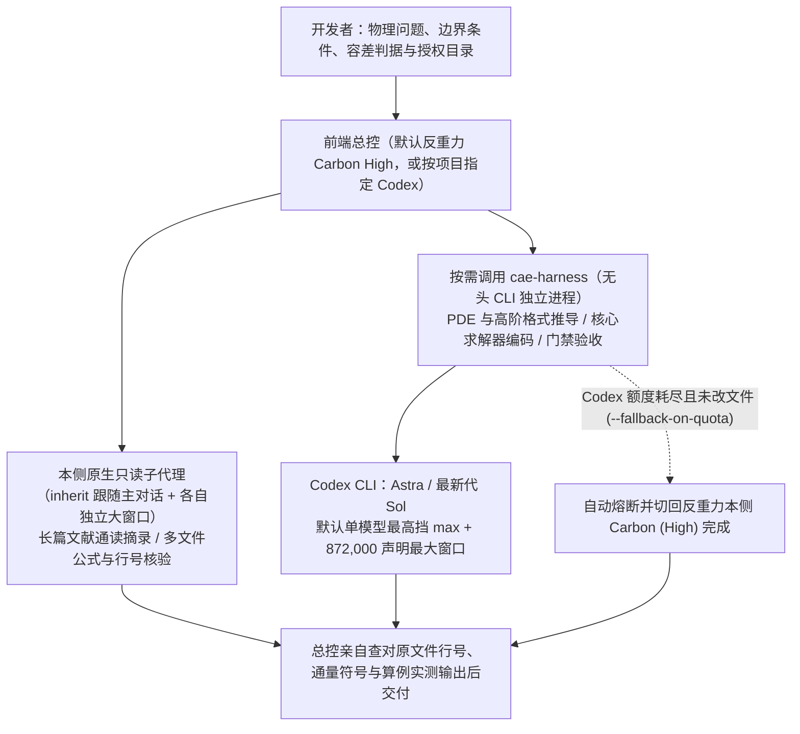

# 反重力与 Codex：面向 AI-CAE 研发的工程规范、独立工作流与双端协作配置

本仓库（`Antigravity_Codex_configuration`）维护 Google Antigravity（反重力）与 OpenAI Codex 共用的科研与工程工作流配置。两套客户端既可各自独立闭环运行，也可通过共享的 `cae-harness` 技能按专长协同攻坚，面向计算流体力学（CFD）、有限元分析（FEA）、偏微分方程（PDE）数值求解器、网格生成与高性能科学计算研发，同时兼容通用软件工程与技术写作。

全仓脚本仅依赖 Python 3.11+ 标准库（零第三方依赖，面向 Windows 与 WSL2／Linux 环境）。

> **English Overview** — `Antigravity_Codex_configuration` provides unified engineering guardrails, lifecycle hooks, strictly read-only subagents, and the cross-client headless orchestrator (`cae-harness`) for **Google Antigravity** and **OpenAI Codex**, tailored to **AI-assisted CAE / CFD / FEA / PDE numerical solver development** and scientific computing (**Python 3.11+ standard library only**, zero third-party packages, targeting Windows and WSL2/Linux):
> - **Deterministic Guardrails & Compaction Recovery**: Restores user specifications from local session transcripts across context compaction and resumption (explicitly flagging any truncated segments), enforces workspace write boundaries (Antigravity Python AST & shell static guards plus unchanged solver-log suppression; Codex `workspace-write` sandboxing plus `cae-harness` snapshot diffs), manages long-session handoffs (Antigravity `normal -> advisory -> drain -> freeze` state machine; Codex `advisory` mode by default, optional `enforce`), and pairs `R3.6` numerical tolerance (`rtol`/`atol`) and empirical order of convergence (EOC) redlines with `cae-harness` (`task` / `gate` `--verify-cmd` and `--write-scope` checks; `task` / `audit` / `gate` `--fallback-on-quota` failover).
> - **Standalone or Bidirectional Deployment**: Supports standalone Antigravity (`--app antigravity`), standalone Codex (`--app codex`), or full bidirectional collaboration (`--app both`). Preview non-destructively via `python -B install.py --probe-apps` and `python -B install.py --dry-run --yes`.
> - **Language Scope**: Machine contracts (`plugin.json`, JSON Schemas, CLI flags, exit codes, and repository file paths) follow standard English conventions, whereas built-in prompt rules (`R0–R11`), subagent instructions, and interactive phrasing guards are authored for **Simplified Chinese** scientific and engineering workflows.

---

## 一、为什么需要这套配置（解决 AI-CAE 研发的真实痛点）

用 AI 辅助推导离散格式、编写和审查大型数值求解器时，最容易在以下四个环节翻车：

1. **长对话自动压缩丢掉前置物理与数值约定**：推导几百行可压缩 Navier-Stokes 离散算子、弯曲网格度量恒等式，或排查 C++/Fortran/Python 混合求解器时，客户端中途触发上下文压缩，把首轮立项定下的无量纲化基准、远场／壁面边界通量正负号或守恒判据直接漏掉。
2. **为凑测试绿灯偷偷放宽容差或虚报“已验证”**：遇到离散守恒残差不降或制造解网格收敛阶（EOC）不达标，模型擅自把 `rtol=1e-12` 改成 `1e-4`、删改测试断言，或者刚改完源码还没跑算例就汇报“验证通过”。
3. **只读审查变顺手改代码、脚本跑偏越界污染其他算例**：本想让子代理独立核查雅可比矩阵（Jacobian）或通量公式，它却顺手改了被审源码；或是命令写偏，在项目目录外新建 `git worktree`、误改相邻算例目录乃至宿主机全局配置。
4. **单一客户端难以兼顾“百万窗口文献统筹”与“硬核公式编码攻坚”**：反重力擅长多篇文献对照、跨模块全局梳理与规范中文技术写作，Codex（`Astra`／`Sol`）擅长深层符号推导、高阶格式稳定性分析与 `872k` 窗口代码闭环；手动在两个窗口间复制粘贴既容易丢条件，遇到某端额度耗尽还会卡在半途。

本仓库通过**全局规则（`R0–R11`）+ 本地同步守护脚本（Hooks）+ 严格只读子代理 + 跨端 CLI 编排器（`cae-harness`）**把上述漏洞逐一堵住：

| AI-CAE 常见翻车点 | 本仓库的解决机制 | 实际作用边界（不夸大） |
| --- | --- | --- |
| 每个新课题都要重复交代中文规范、精简目录与容差红线 | 双端统一部署全局规则 `R0–R11`；具体控制方程与离散参数留在项目内 `AGENTS.md` | 固化通用科研与工程纪律，不覆盖具体算例的物理模型与收敛判据 |
| 上下文自动压缩或跨天续接后，忘掉首轮假设与中途拍板 | 压缩／恢复钩子自动从本地会话轨迹提取并归档全部用户原话 | 自动提醒模型重读磁盘原话核对；底层轨迹本身被截断时如实标明缺口 |
| 独立核查时顺手改坏源码，失去第三方复核意义 | 双端对称配置三个严格只读子代理（通读摘录、审计核验、数理推导与润色协作） | 读写权限物理隔离；所有审查发现必须附文件路径与行号交回总控复核 |
| 严禁放宽 `rtol`／`atol`，区分“改完代码”与“算例跑通” | `R3.6` 验收红线 + 结构化 JSON 回执 + `cae-harness gate` 外部验证命令门禁 | 仅对当前目标环境与核心验证链路如实标注未实测项，不罗列无关外围平台免责 |
| 擅自添加老版本回退分支、多余抽象与假想兼容层 | `R3.3` 控制范围与反过度工程红线 + 阶段收口双端清淤把关 | 聚焦当前明确需求与主力环境（Python 3.11+、Windows／WSL2），砍掉冗余样板代码 |
| 越界修改相邻算例、建外部 `git worktree` 或改乱全局配置 | `R4` 目录硬边界 + Python AST／Shell 子句静态检查 + Codex `workspace-write` 沙箱 | 项目外写删须经用户明确批准；系统标准临时目录与运行缓存正常放行 |
| 同一个算例残差日志被反复空读、空等套话连续刷屏 | 日志复合指纹门禁 + 回复数值进展识别守卫 | 日志内容有变化或迭代步数／残差有推进才放行，拦截原地空转刷屏 |
| 会话已频繁压缩丢细节，还在继续派任务铺摊子 | 长会话分级预警、排空（`drain`）、冻结（`freeze`）与交接四要素核验 | 反重力自动收口生成【新对话提示词】；Codex 默认采用 `advisory` 提醒不强停 |
| 跨端攻坚选错轻量模型，或对侧配额耗尽后死循环重试 | 默认满血旗舰选模配窗（按需才降挡省流）+ 额度冷却熔断与 `--fallback-on-quota` 本侧回退 | 预检或启动期额度耗尽且工作区未改动时，自动切回本侧匹配旗舰模型完成 |

---

## 二、三套部署模式怎么选

仓库安装器会自动探测本机与跨子系统（Windows `<->` WSL）已安装的客户端，单端与双端共用同一套源码，互不绑架：

| 部署模式 | 适用人群 | 安装参数 | 实际部署内容与生效路径 |
| --- | --- | --- | --- |
| **双端协同（推荐）** | 同时安装了反重力与 Codex，希望文献统筹与硬核公式／求解器编码互补 | `--app both`（或默认 `auto`） | 同时配齐下方两端的全部独立能力，并打通 `cae-harness` 双向无头调用与额度熔断回退 |
| **单反重力模式** | 只用 Google Antigravity | `--app antigravity` | 安装 `~/.gemini/config/plugins/user-guard` 原生插件（`R0–R11`、四类守护钩子、三个只读子代理、共享技能与可选 `zotero-mcp`） |
| **单 Codex 模式** | 只用 OpenAI Codex | `--app codex` | 同步 `~/.codex/AGENTS.md`（自动保留末尾自定义 `## 工具与本机` 段落）、三个只读子代理（`~/.codex/agents/*.toml`）、原话恢复与交接钩子、`workspace-write` 沙箱基线及可选 `zotero-mcp` |

---

## 三、日常怎么用：四层执行架构与双端配合流

### 1. 四类执行层职责边界（彻底理清谁归谁管）

| 执行层 | 运行位置 | 上下文窗口形态 | 模型与思考挡位由谁决定 |
| --- | --- | --- | --- |
| **前端交互主会话** | 反重力或 Codex 当前桌面／终端窗口 | 当前主会话窗口 | 用户在前端界面自选，运行期钩子与 `cae-harness` 绝不反向修改（升级安装默认亦保留已选模型） |
| **宿主内置复合模式** | 宿主内部（如反重力 `Orchestrator`） | 单一会话内多模型交替共享同一个窗口（容量不叠加） | 宿主固定编排，不支持外部传 `--effort` 调挡 |
| **本侧原生只读子代理／工作流** | 反重力 `invoke_subagent`、`run_workflow` 或 Codex 原生子代理 | 每个子代理拥有独立的子会话大上下文窗口 | 反重力侧默认 `inherit` 完全跟随主会话模型与挡位（10+ 同构目录只读盘点可用 `run_workflow` 扇出），不受 `cae-harness` 影响 |
| **`cae-harness` 跨端 CLI** | 按需启动的 `codex exec` 或 `agy` 独立无头进程 | 全新隔离会话，自动下发所选模型声明的最大上下文窗口 | 由 `cae-harness` 按任务性质独立读取运行侧模型目录选定，不受前端主控模型影响 |



`cae-harness` 只是本仓库内的一份纯标准库 Python 脚本，**仅调用用户在本机通过官方渠道安装并登录的 `codex` 与 `agy` CLI**，不经过任何第三方中转接口，未调用时也不在后台常驻。

### 2. 日常科研与求解器开发四步配合法

1. **反重力主控统筹 + 原生 `inherit` 子代理并行读文献／审代码**：
   日常课题推进推荐在反重力前端选择单模型 **`Gemini 4 Carbon (High)`**。相比在同一窗口内交替调用模型的 `Orchestrator (Carbon)`，纯 `Carbon (High)` 单轮持续推理更稳，且通过 `invoke_subagent` 唤起的 `readonly-reader`、`readonly-auditor`、`readonly-collaborator` 会自动继承 `Carbon (High)` 并各自获得独立的约 `1M` 标称上下文窗口，适合并行通读多篇参考文献或跨几十个源文件摘录边界条件与算子实现。
2. **硬核数理推导、核心编码与门禁审查工作流优先交由 Codex 端攻坚（默认满血旗舰 + 按需省流）**：
   双端均可用时，凡涉及雅可比矩阵推导、DGSEM／WENO 离散守恒与熵稳定证明、CFL 步长分析、核心求解器模块编写、深层边界核查与门禁测试，**优先通过 `cae-harness` 发起 Codex 无头工作流**（发挥其深度推理、高保持率长上下文与 `workspace-write` 工程沙箱优势），改完跑过门禁后交回反重力总控做最终验收：
   - **数学推导、路线论证与高复杂度数理审查（`math`／`direction`）**：自动优选深度推理旗舰 **`Astra`**（`gpt-6-astra`）；
   - **求解器代码实现、常规审查、大型代码审计与验证门禁（`code`／`review`／`audit`／`gate`）**：自动优选最新代工程旗舰 **`Sol`**（`gpt-6.1-sol`，多代并存时自动取最新代）；
   - **默认满血与按需省流**：除纯文字润色（`polish` 短篇保持 `medium`、长篇保持 `high` 防过度发挥）外，默认一律启用所选旗舰模型的**单模型纯思考最高挡 `max`**（跳过内部二次派生的 `ultra` 挡防套娃烧穿配额），并显式下发模型声明最大上下文窗口（当前目录为 **`872,000` token**）。**只有当用户明确或模糊提出降挡、省额度、省 token 时**，脚本才切换为分级省流模式（常规任务用 `high`，表面格式／拼写微查启用轻量模型 + `low`）。
3. **附带 `--fallback-on-quota` 兜底额度波动**：
   当 Codex 处于用量冷却期或在预检／启动阶段报 `quota_exhausted` 且尚未改动工作区文件时，脚本立即记录冷却时间阻断盲目重试，并自动切回反重力本侧匹配的旗舰模型与最高可用挡位（如 `gemini-4-carbon-high`）继续完成任务，切换详情完整记入回执 `quota_fallback` 字段。
4. **阶段收口与发版前双端全量把关**：
   里程碑收口或发版前对全量文件分工闭环——由 Codex 无头工作流承担全仓代码回归检查、Debug 排错、死代码／性能优化与验证门禁测试；由反重力承担全仓文档书面语润色、冗余清淤精简与隐私凭据脱敏把关，经总控逐行复核代码差异与运行证据后合并交付。

---

## 四、模型、挡位与五层上下文能力矩阵

**核验日期：2026-11-14。** 下表汇总官方公开文档、本机客户端模型目录声明及受控实测结果；实际运行时以当前执行侧读取到的模型目录为准。

### 1. 双端主要模型规格对照

| 客户端／模型 | 研发场景定位 | 可调思考挡位／运行机制 | 上下文窗口依据 |
| --- | --- | --- | --- |
| Codex：`GPT-6-Astra` | 偏微分方程推导、高阶格式分析、复杂物理建模与根因排查 | 目录支持 `low/medium/high/xhigh/max/ultra`（后台默认选 `max`） | 本机目录声明默认 `272,000`、最大 `872,000` token（有效比 95%） |
| Codex：`GPT-6.1-Sol` | 求解器核心编码、常规审查、全仓审计与验证门禁主力 | 同上六挡（后台默认选 `max`；用户要求降挡／省 token 时降为 `high`） | 官方默认 `500,000`；本机目录声明最大 `872,000` token |
| Codex：`GPT-6.1-Terra` | 多模态图表理解、界面交互与边界明确的代码修改 | 同上六挡 | 本机目录声明默认 `500,000`、最大 `872,000` token |
| Codex：`GPT-6-Luna` | 仅在用户要求降挡／省 token 且属表面拼写／格式微查时启用 | 目录支持至 `max`（不含 `ultra`） | 本机目录声明默认 `272,000`、最大 `872,000` token |
| 反重力：`Gemini 4 Carbon`／`Argon` | 推荐前端主会话总控、长文献综合与跨模块架构把关 | 当前 CLI 目录提供 `low/medium/high`，单模型最高可用挡为 `high` | Google 官方公布 API 窗口 `1,048,576` token；客户端受自动检查点策略管理 |
| 反重力：`Gemini 4 Hydrogen`／`Gemini 3.8 Flash` | 快速辅助编码与按需省流模式下的表面格式微查 | `Hydrogen` 提供 `low/medium/high/xhigh`（前端 `Extra` 即 `xhigh`） | `/context` 面板显示约 `1.0M`，CLI 单条消息长度与检查点阈值另算 |
| 反重力：`Orchestrator (Carbon/Argon)` | 单一窗口内由 Carbon/Argon 规划审阅、Hydrogen 实施 | 固定复合配置，不可传 `--effort`；并非多子代理并发 | 内部子模型共享同一会话窗口，总容量不会叠加 |
| 反重力第三方托管：`Claude Sonnet/Opus 5.5 (thinking)` | 长周期稀缺配额第三方模型（`cae-harness` 默认排除，仅在显式点名时调用） | 托管推理模式（注：`Claude 4.6` 与 `GPT-OSS-120b` 于 `2026-11-18` 下线，切换后在仓库根目录运行 `python -B template/user-guard/skills/cae-harness/scripts/cae_harness.py probe --discover-models` 刷新本地目录缓存） | 受托管平台配额与会话检查点策略管理 |

参考文档：[OpenAI Codex 模型说明](https://learn.chatgpt.com/docs/models)、[Antigravity 模型说明](https://antigravity.google/docs/models)、[Gemini 4 Hydrogen 与 Orchestrator 公告](https://antigravity.google/blog/gemini-4-hydrogen-in-google-antigravity)、[Google Gemini 窗口规格表](https://docs.cloud.google.com/gemini-enterprise-agent-platform/models/migrate)。

### 2. 区分上下文窗口的五个层级（避免把“标称窗口”当成“单次塞入上限”）

1. **目录／API 声明最大窗口**：模型支持的最大上下文容量（如 Codex 目录声明 `872,000` token、Gemini 4 API 公布 `1,048,576` token）。`cae-harness` 启动 Codex 时显式下发 `-c model_context_window=<最大声明窗口>`。
2. **单条消息入口上限**：客户端单次 RPC 请求允许送入的字符／字节数。`2026-11-13` 受控实测显示：Codex `turn/start` 单条消息上限为 `1,048,576` 字符；反重力 CLI `1.5.8` 单条消息达 44～66 万字节时出现入口截断标记，改为每轮约 13 万 UTF-8 字节分批送入则无截断（超长源码应让模型在目录内按文件读取，而非硬塞进单条提示词）。
3. **宿主自动检查点（压缩）触发点**：客户端在累积多少 token 后自动把早期对话折叠成摘要。实测 Codex `GPT-6.1-Sol` 分轮累积至 `808,892` 输入 token（占 `828,400` 有效窗口的 **97.65%**）时未触发压缩，首中尾 6 处随机口令 **6/6 全部精确命中**；反重力 CLI `1.5.8` `Hydrogen` 累积至 `241,625` token 时 **6/6 全中**，继续追加至 `290,028` token 时触发自动检查点压缩（压缩后降至 `14,063` token，早期随机细节凭摘要无法找回）。完整测试记录见[架构设计与生命周期钩子规范](docs/architecture-and-hooks.md)。
4. **分片审计输入预算**：`cae-harness audit` 扣除系统提示词、文件清单与 JSON Schema 开销并预留安全余量后的单批源码上限（可通过 `--codex-input-budget`、`--agy-input-budget` 调整）。
5. **实际阅读覆盖**：子任务真正读完了哪些文件与行号，以结构化回执和总控抽查为准。发生上下文压缩后，严格按 `R9` 重读原话归档核对缺口，绝不盲目重跑已经落盘的代码修改。

### 3. `cae-harness` 选模与思考挡位速查表

| 场景分类 | 选模与挡位策略 |
| --- | --- |
| **默认满血模式**（`math`／`direction`／`code`／`review`／`audit`／`gate`） | 只选旗舰专长模型（`Astra`／最新代 `Sol`／`Carbon`）+ 所选模型**单模型纯思考最高挡**（Codex `max`、反重力 `Carbon` `high`）+ 声明最大窗口，绝不自动降级轻量小模型 |
| **纯文字润色**（`polish`） | 旗舰主力模型 + 短篇 `medium`／长篇 `high`（抑制过度改写，严防 R5 无声放大） |
| **按需省流模式**（仅当用户明确或模糊提出降挡、省额度、省 token 时启用） | 常规编码／审查／审计用 `high` 挡（`gate` 首轮失败第 2 轮仍可升至 `max` 排错）；仅表面拼写／格式微查切至轻量高速模型（`Luna`／`Hydrogen`）+ `low` 挡 |

---

## 五、`cae-harness` 常用命令速查

在仓库根目录可直接调用（Windows 用 `python`，WSL2／Linux 用 `python3`；部署后也可在技能目录内执行）：

```sh
# 1. 只读评估本机双端模型目录、声明窗口与各任务推荐选路（零写入）
python -B template/user-guard/skills/cae-harness/scripts/cae_harness.py assess --caller antigravity

# 2. 反重力调 Codex 推导 PDE 离散格式／雅可比矩阵（自动选 Astra + max 挡 + 872k 窗口；配额耗尽自动回退本侧）
python -B template/user-guard/skills/cae-harness/scripts/cae_harness.py task --caller antigravity --engine codex:default --kind math --tier max --fallback-on-quota --target "<项目目录>" --task-file "<任务单.md>"

# 3. 反重力调 Codex Sol 实现求解器算子并执行守恒律／收敛阶门禁验收
python -B template/user-guard/skills/cae-harness/scripts/cae_harness.py gate --caller antigravity --worker codex:sol --tier max --fallback-on-quota --target "<项目目录>" --task-file "<任务单.md>" --write-scope "src/*.py" --verify-cmd "python -B -m unittest discover -s tests"

# 4. Codex 调反重力润色论文或技术报告段落（先 --dry-run 预演）
python -B template/user-guard/skills/cae-harness/scripts/cae_harness.py task --caller codex --engine agy:default --kind polish --tier medium --target "<项目目录>" --task-file "<任务单.md>" --dry-run
```

> **Windows 版 Codex 反向调用 `agy.exe` 的沙箱权限说明**：反重力主会话直接启动 `codex` 可正常访问宿主机 `.codex` 目录；但若在 Windows 版 Codex 的受限工作区沙箱内反向启动 `agy.exe`，沙箱默认只放行当前项目目录与 `%TEMP%`，会阻止 `agy.exe` 向 `~/.gemini/antigravity-cli` 写入状态锁导致卡死超时。确需从 Windows Codex 反向调 `agy` 时，须通过放行 `~/.gemini` 写权限的宿主通道运行，并将 `--timeout` 设为 `300` 秒以上。

更多实战技巧与参数细节见[工程及科研协作实践指南](docs/workflow-guide.md)与 [`cae-harness` 技能手册](template/user-guard/skills/cae-harness/SKILL.md)。

---

## 六、安装、升级与回归验证

### 1. 一键探测、预演与安装

```sh
git clone https://github.com/Xinyu-Li-1997/Antigravity_Codex_configuration.git
cd Antigravity_Codex_configuration

# 第一步：只读探测本机与 WSL 客户端安装状态（零写入）
python -B install.py --probe-apps

# 第二步：空跑预演变更计划，查看拟写入的全局路径（零写入）
python -B install.py --dry-run --yes
```

你也可以直接用反重力或 Codex 打开本仓库，把下面这句话发给当前助手自动引导配置：

> 请按仓库 `AGENTS.md` 先探测并预演本机配置，列出拟写入路径，保留我现有的模型选择和本机自定义说明，等我确认后再正式安装。

确认预演无误后执行正式安装：
- **Windows（PowerShell）**：`powershell -NoProfile -ExecutionPolicy Bypass -File .\install.ps1`
- **WSL2／Linux**：`bash install.sh`

| 安装器常用参数 | 作用说明 |
| --- | --- |
| `--app auto/codex/antigravity/both` | 指定部署范围（默认 `auto` 自动探测已安装客户端） |
| `--probe-apps` | 只读输出本侧与跨子系统（Windows `<->` WSL）客户端探测 JSON |
| `--dry-run` | 仅打印拟执行的同步计划，不修改任何磁盘文件 |
| `--yes` | 跳过交互确认提示（适合已在对话中获用户明确批准后执行） |
| `--sync-model-defaults` | 将前端默认模型显式更新为推荐配置（默认升级保留用户自选模型） |
| `--no-model-config` | 完全跳过模型配置逻辑（与 `--sync-model-defaults` 互斥） |
| `--codex-handoff-mode advisory/enforce/off` | 设置 Codex 长会话交接模式（首次安装默认 `advisory` 仅提醒，升级保留原配置） |
| `--codex-handoff-compactions N` | Codex `enforce` 模式下的压缩次数阈值（默认 `0` 不按次数强停） |
| `--no-zotero` | 跳过可选的 `zotero-mcp` 文献检索服务配置 |

### 2. 仓库修改后的四步回归清单

改动本仓库安装器、钩子或编排脚本后，须依次完成以下检查再提交：

1. **双端分工回归与目录核对**：运行 `probe`／`assess` 检查最新客户端版本、模型目录、声明窗口与挡位（未知项如实标“未知”）；双端均可用时，由 Codex 完成全量代码回归检查与 Debug 优化，由反重力完成全量文档润色、清淤精简与脱敏审查。
2. **三模式临时沙箱隔离安装**：
   ```sh
   python -B install.py --app codex --codex-home "<临时目录>/codex_home" --no-zotero
   python -B install.py --app antigravity --target-dir "<临时目录>/plugins/user-guard" --no-zotero
   python -B install.py --app both --target-dir "<临时目录>/plugins/user-guard" --codex-home "<临时目录>/codex_home" --no-zotero
   ```
3. **全量离线单元测试与 Python 3.11+ 语法回归**：
   ```sh
   python -B -X utf8 -m unittest discover -s tests -p "test_*.py" -v
   ```
4. **宿主实测与隐私脱敏扫描**：涉及宿主钩子协议或模型选路改动时，补充受控实测并记入[架构设计与生命周期钩子规范](docs/architecture-and-hooks.md)；确认不含个人用户名路径、具体硬件型号或密钥凭据后，经用户批准再提交推送或同步生产配置。

---

## 七、仓库目录导览与开源许可

```text
Antigravity_Codex_configuration/
├── README.md                                 # 仓库总入口：痛点定位、英文导引、三套部署模式与快速上手
├── CHANGELOG.md                              # 项目版本演进与宿主协议适配更新日志
├── LICENSE                                   # Apache License 2.0 开源许可证
├── AGENTS.md                                 # 供反重力与 Codex 助手共读的四步本机自举配置与维护规范
├── install.py / install.ps1 / install.sh     # 跨平台安装器：探测预演、TOML 无损合并、越界链接防护与幂等同步
├── .github/workflows/ci.yml                  # 跨平台自动回归门禁（Windows + Ubuntu 三模式沙箱与离线测试）
├── docs/
│   ├── workflow-guide.md                     # 日常科研与数值求解器开发实战配合指南
│   └── architecture-and-hooks.md             # 代码分区总览、钩子事件协议、状态机算法与受控实测记录
├── template/
│   ├── user-guard/                           # 反重力原生插件及双端同源核心模板
│   │   ├── plugin.json / hooks.json / README.md
│   │   ├── assets/logo.svg                   # 极简插件矢量图标（通过官方 --strict 校验）
│   │   ├── rules/AGENTS.md                   # 双端共用的 R0–R11 全局工程与科学计算规则
│   │   ├── hooks/*.py                        # 原话归档回溯、目录硬边界、防空转刷屏与长会话交接 5 个模块
│   │   ├── agents/readonly-*.md              # 反重力三个 inherit 只读子代理（通读、审计、数理推导与润色）
│   │   └── skills/cae-harness/               # 双端 CLI 协作技能手册（SKILL.md）与编排器（cae_harness.py）
│   └── codex/
│       ├── hooks.json                        # Codex 五类生命周期事件模板
│       └── agents/readonly-*.toml            # Codex 三个 read-only 只读子代理定义
└── tests/                                    # 安装器、边界守卫、压缩恢复与跨端编排全量离线测试套件
```

本仓库仅调用用户通过官方渠道安装并登录的 `codex`、`agy` CLI 与可选 `zotero-mcp` 工具，不内置任何第三方中转、私有凭据或绕过官方权限与计费的逻辑。采用 [Apache License 2.0](LICENSE) 开源许可（`Copyright 2026 Xinyu-Li-1997`）。
